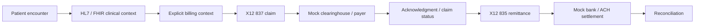

# Healthcare Revenue Cycle Integration Lab

**Follow one synthetic patient encounter from clinical context to a reconciled payment.**

An independently authored .NET portfolio project exploring the boundaries between healthcare interoperability, claims processing, and financial settlement. The architecture centers on a durable revenue-cycle orchestrator and the identifiers that connect these systems.

**Current milestone: runnable repository scaffold.** The API and mock payer start and expose health and metadata. Encounter ingestion, claim creation, and payer submission are the next Phase 1 work; they are not implemented yet. All scenarios will use synthetic data only.

## The portfolio story

A clinical event can become a claim, but submitting that claim is only one step. Payer receipt, adjudication, remittance, and cash settlement represent different outcomes. This lab will make those boundaries visible through workflow state, correlation, and recoverable failure scenarios.



This diagram is the target architecture. The scaffold does not execute this workflow yet.

The intended engineering evidence is practical: follow a claim across HTTP boundaries, prove a repeated request does not create a second submission, recover from an ambiguous timeout, and explain why remittance does not by itself prove bank settlement.

## Run locally

Requires the **.NET 10 SDK**. `global.json` permits installed stable .NET 10 feature bands. PowerShell 7 is required only for the smoke script.

From the repository root:

```powershell
dotnet build RevenueCycle.slnx --configuration Release --disable-build-servers -m:1
dotnet run --project src/RevenueCycle.Api --configuration Release --no-build --no-launch-profile -- --urls http://127.0.0.1:5221
```

In a second terminal:

```powershell
dotnet run --project src/RevenueCycle.MockPayer --configuration Release --no-build --no-launch-profile -- --urls http://127.0.0.1:5222
```

| Host | Metadata | Health |
| --- | --- | --- |
| Revenue-cycle API | http://127.0.0.1:5221/ | http://127.0.0.1:5221/health |
| Mock payer | http://127.0.0.1:5222/ | http://127.0.0.1:5222/health |

Health means the host is running. It does not indicate payer connectivity or workflow readiness. The metadata explicitly reports workflow/submission availability as `false`.

Build and check both hosts automatically:

```powershell
pwsh -File scripts/smoke.ps1
```

The script uses ports 5221/5222, writes ignored logs under `artifacts/`, and stops the processes it starts. Alternate ports can be supplied with `-ApiPort` and `-PayerPort`.

## Docker

```powershell
docker compose up --build
```

Both services use the same ports as the local instructions, bound to loopback. Stop local hosts first. Each container runs as the .NET image's non-root app user. At this milestone there is no database, volume, or service-to-service call.

**[UNVERIFIED -- Docker was unavailable in the scaffold development environment.]** CI includes a container build; a successful remote run has not yet been observed.

## Repository structure

```text
src/
  RevenueCycle.Domain/          Workflow stage vocabulary and correlation model
  RevenueCycle.Application/     Application layer and scaffold capability metadata
  RevenueCycle.Infrastructure/  Reserved persistence and integration adapters
  RevenueCycle.Api/             Composition root and inspection API host
  RevenueCycle.MockPayer/       Independent synthetic payer host
docs/                          Architecture, decisions, roadmap, demo criteria
samples/                       Synthetic-fixture policy; fixtures come next
tests/                         Test plan; behavioral suites come with implementation
scripts/                       Executable scaffold smoke check
```

## Delivery status

| Capability | Status |
| --- | --- |
| Layered .NET solution, two HTTP hosts, health and metadata | Implemented |
| Initial workflow stages and correlation record | Implemented; no transition logic |
| Smoke script and GitHub Actions build workflow | Included; local smoke verified |
| Docker packaging | Included; execution unverified |
| FHIR subset ingestion and explicit billing input | Phase 1 next |
| Durable orchestrator, SQLite store, 837 subset, payer submission | Phase 1 next |
| Idempotency, retries, circuit breaker, manual recovery | Phase 1 next |
| OpenTelemetry and workflow inspection endpoints | Phase 1 next |
| HL7 v2 adapter, acknowledgment/status, 835 | Later phases |
| Mock bank settlement, reconciliation, dedicated UI | Later phases |

See [architecture](docs/architecture.md), [design decisions](docs/decisions.md), [roadmap](docs/roadmap.md), and [demo acceptance criteria](docs/demo-scenarios.md).

## Standards and scope

The planned FHIR adapter targets an explicitly documented R4 subset. The planned 837 adapter is educational and will declare its supported segments; this project does not claim full standards conformance, trading-partner certification, or production compliance. No licensed X12 implementation guides are bundled. There are no live clinical, payer, or banking connections and no employer code or assets.

Primary references: [HL7 FHIR R4 Encounter](https://hl7.org/fhir/R4/encounter.html), [X12 healthcare transaction flow](https://x12.org/flow/health-care), and [Microsoft's .NET container guidance](https://learn.microsoft.com/aspnet/core/host-and-deploy/docker/building-net-docker-images).
