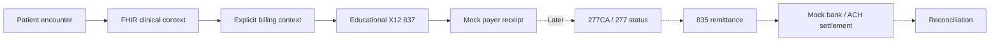

# Healthcare Revenue Cycle Integration Lab

**Follow one synthetic patient encounter from clinical context to a reconciled payment.**

An independently authored .NET portfolio project connecting healthcare interoperability, claims processing, and financial settlement. The central design is a durable revenue-cycle orchestrator with explicit business correlations and recoverable failures.

**Phase 1b is implemented:** synthetic FHIR R4 subset → explicit billing → educational 837 artifact → mock payer receipt. Later phases add HL7 v2, payer responses, remittance, bank settlement, and reconciliation. This lab uses synthetic data only and has no live payer or banking connections.

## The portfolio story

Submitting a claim is only one step. Receipt, adjudication, remittance, and cash settlement represent different outcomes. This lab makes those boundaries visible through workflow history, stable identifiers, and failure demonstrations.



The current evidence is concrete: repeat ingestion without creating another claim, exhaust a retry budget, reopen a circuit, requeue a failed workflow, and restart both services after the payer accepts a request whose response never reaches the orchestrator.

## Run locally

Requires .NET 10 SDK; verification scripts also require PowerShell 7. Public NuGet access is needed on first restore. From the repository root:

```powershell
dotnet build RevenueCycle.slnx -c Release --disable-build-servers -m:1
dotnet run --project src/RevenueCycle.MockPayer -c Release --no-build --no-launch-profile -- --urls http://127.0.0.1:5222
```

In a second terminal:

```powershell
dotnet run --project src/RevenueCycle.Api -c Release --no-build --no-launch-profile -- --urls http://127.0.0.1:5221
```

In a third terminal, submit the synthetic fixture:

```powershell
$workflow = Invoke-RestMethod http://127.0.0.1:5221/workflows -Method Post -ContentType application/json -Headers @{ 'Idempotency-Key' = 'demo-001' } -Body (Get-Content samples/encounter.json -Raw) -NoProxy
Invoke-RestMethod "http://127.0.0.1:5221/workflows/$($workflow.correlation.workflowId)" -NoProxy
```

The worker moves the persisted workflow from `SubmissionPending` to `Submitted`. Poll the inspection request until it completes. Repeating the same input and key returns the original workflow. Changing that input under the same key returns `409`.

| Endpoint | Purpose |
| --- | --- |
| `POST /workflows` | Validate synthetic clinical/billing input and queue a claim atomically |
| `GET /workflows` | Most recently due 100 workflows, identifiers, and stage |
| `GET /workflows/{id}` | Clinical/billing context, claim, history, attempts, and correlation |
| `GET /workflows/{id}/claim` | Stored educational 837 text |
| `POST /workflows/{id}/recover` | Requeue ManualReview with an audited reason code |
| `GET /openapi/v1.json` | API contract |
| `GET /health` | Host liveness; does not assert payer availability |
| Mock payer: `GET /claims` | Persisted payer receipt identities |

The API runs on port 5221; the payer on 5222. SQLite files default to each host's output `data/` directory. Set `Storage__Directory` to move them. The fixture uses a single encounter ID; use new encounter IDs and keys for new workflows.

## Verify behavior

```powershell
dotnet test RevenueCycle.slnx -c Release --disable-build-servers -m:1
pwsh -File scripts/smoke.ps1
```

The smoke script creates isolated databases and logs under ignored `artifacts/smoke/`, launches both hosts, and stops only its own processes. It exercises normal submission, duplicate/conflicting input, permanent rejection, circuit opening/recovery, manual requeue, and lost-response recovery across service restarts. Allow roughly two minutes. Ports can be changed with `-ApiPort` and `-PayerPort`.

## Failure and telemetry demonstrations

Run the payer with `--Payer:Mode Unavailable` to return 503, `Reject` to return a permanent 422, or `AcceptThenTimeout` to persist the first receipt before delaying its response. Existing matching receipts are returned immediately, including after restart.

The default worker allows four attempts per recovery cycle, with bounded exponential backoff and jitter. Permanent failures enter `ManualReview` immediately. For manual recovery, restart the payer with `Accept`, allow an open circuit's ten-second break to expire, and send:

```powershell
Invoke-RestMethod "http://127.0.0.1:5221/workflows/$($workflow.correlation.workflowId)/recover" -Method Post -ContentType application/json -Body '{"reasonCode":"PayerRestored"}' -NoProxy
```

This preserves the claim and submission identity, adds a history entry, and starts a new finite retry cycle. It is only valid for `ManualReview` workflows.

OpenTelemetry includes inbound/outbound HTTP traces, a `payer.submit` span with business IDs and outcome, HTTP metrics, and the `revenue_cycle.submissions` counter. Use `--Telemetry:Console true` for console export or configure `OTEL_EXPORTER_OTLP_ENDPOINT` for OTLP export. No exporter is enabled by default. Clinical payloads are excluded from logs and spans; metric labels contain outcomes rather than claim/patient IDs.

## Docker and local telemetry viewer

```powershell
docker compose up --build
```

Compose provides separate persistent database volumes and the Aspire telemetry dashboard at http://127.0.0.1:18888. API and payer ports remain 5221/5222. Stop locally running hosts first. Host ports bind to loopback; the dashboard is configured for anonymous local development. There is no custom workflow UI yet; inspect workflow state through the API.

**[UNVERIFIED -- Docker is unavailable in the development environment.]** Container startup and OTLP dashboard rendering still require validation on a Docker host. Local .NET execution and console telemetry are verified independently.

## Architecture and status

| Component | Responsibility |
| --- | --- |
| Domain | Clinical/billing/claim models, guarded transitions, history, correlations |
| Application | Validation, claim writer, orchestration, retry decisions, adapter contracts |
| Infrastructure | EF Core SQLite, atomic queue/lease updates, HTTP resilience, telemetry bootstrap |
| API | Composition root, ingestion, inspection, and manual recovery |
| MockPayer | Separate SQLite receipt store and deterministic failure modes |

Phase 1b implements durable workflow state, idempotency, retry budgets, circuit breaking, manual recovery, OpenAPI, and OpenTelemetry. HL7 v2, 277CA/277, 835, settlement, reconciliation, and dedicated UI remain roadmap work.

See [architecture](docs/architecture.md), [input and transaction scope](docs/contracts.md), [design decisions](docs/decisions.md), [roadmap](docs/roadmap.md), [demo criteria](docs/demo-scenarios.md), and [verified results](docs/validation.md).

## Scope and limits

This is a production-oriented learning lab, not a production healthcare system. It has no authentication, complete FHIR validation, certified X12 generation, or compliance claim. Inputs explicitly assert synthetic provenance; that assertion is not a real-data detector. There are no employer assets, real patient fixtures, or licensed X12 implementation guides in this repository.

The current 837 text deliberately uses fictional procedure codes and omits required trading-partner content. It must not be submitted to a real clearinghouse. Payer receipt is not adjudication, remittance, or cash settlement.

Primary references: [FHIR R4 Encounter](https://hl7.org/fhir/R4/encounter.html), [X12 healthcare transaction flow](https://x12.org/flow/health-care), [.NET HTTP resilience](https://learn.microsoft.com/en-us/dotnet/core/resilience/http-resilience), and [standalone Aspire dashboard](https://aspire.dev/dashboard/standalone/).
