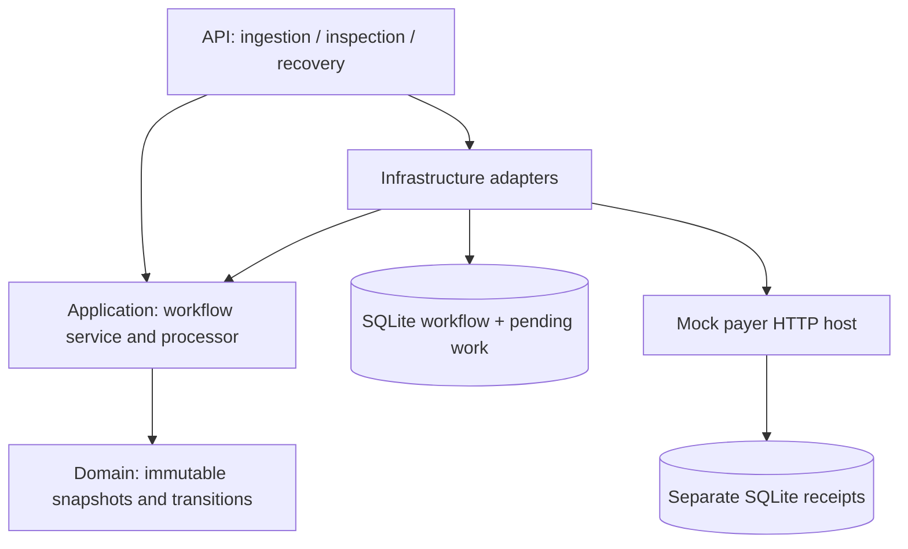
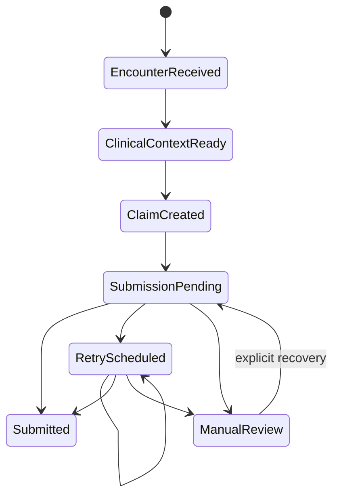

# Architecture

## Executable boundaries

The API composes the application and infrastructure layers. Application owns contracts and orchestration; Domain depends on no framework. The mock payer shares wire DTOs and telemetry/bootstrap utilities through the current Infrastructure reference, but does not register the workflow worker or access its database. Extracting those shared utilities into a small separate library is an option if the mock grows.

## Ingestion transaction

The strict input adapter accepts an explicitly synthetic Patient/Encounter resource subset and separately supplied billing. It validates references, finished ambulatory status, date bounds, diagnosis syntax, fictional procedure codes, quantities, and money precision. It does not derive billing from clinical prose.

The service creates an immutable clinical/billing snapshot, a stable claim ID, an educational 837 artifact, and four history entries. One SQLite row stores that document together with unique ingestion key, input fingerprint, unique encounter ID, stage, due time, version token, and lease expiry. The insert atomically creates both the workflow and its pending work; there is no separate broker or dual-write window. Initial validation/claim transitions are committed together, not independently observable intermediate jobs.

A replay with identical typed input and key returns the existing workflow. Changed input under that key or another key for the same encounter returns 409. Fingerprints cover typed serialization, so JSON whitespace/property order is irrelevant; array order and supplied timestamps remain significant. This phase intentionally supports one claim per encounter.

## Durable execution and concurrency

The hosted worker polls every 250 ms. It acquires a due row with an atomic compare-and-swap version change and a 30-second lease. Saving an attempt before the HTTP call consumes its durable budget. All subsequent updates require the version token; an expired worker cannot overwrite another worker's acquired state.

If the process stops mid-attempt, the lease expires and a new worker marks the unfinished attempt `UnknownAfterRestart`. It reuses the stored claim/artifact and submission key. An exhausted budget enters manual review instead of sending again. The payer inserts its receipt under a unique claim ID and fingerprint before returning; a repeat returns the same receipt across payer restarts. A conflicting body returns 409.

Delivery is at least once. Leases reduce concurrent processing; payer deduplication is the correctness boundary for an accepted request with a missing response. This design is verified against local SQLite, not established as a horizontally scaled deployment guarantee.

## State machine

`Submitted` means the mock payer receipt was durably recorded. It does not mean acknowledged by 277CA, adjudicated, paid, or reconciled. Terminal success cannot be manually requeued.

| Identifier | Assignment |
| --- | --- |
| WorkflowId | Internal ingestion/workflow identity |
| EncounterId | Validated source encounter identity |
| ClaimId | Generated once at claim creation; also payer idempotency key |
| PayerClaimId | Generated by mock payer on first receipt |
| TraceNumber | Reserved for later remittance/payment business correlation |
| PaymentReference | Reserved for later bank settlement correlation |

TraceNumber is not an OpenTelemetry trace ID. Later phases must expand the model for batches, partial/split payments, and many-to-many claim/payment matching.

## Resilience policy

- Four attempts per recovery cycle by default. The budget includes circuit-open decisions and interrupted attempts.
- Transient outcomes: transport failure, timeout, HTTP 408/429/5xx, or open circuit. Permanent responses and invalid receipts enter manual review.
- Exponential delay starts at two seconds, caps at thirty seconds, and samples jitter between half and all of the calculated delay. Retry-After is not interpreted in this lab.
- HTTP resilience uses Polly via Microsoft.Extensions.Http.Resilience: three-second request timeout; five-second outer HttpClient limit; circuit opens at 50% transient failures with at least three observations in thirty seconds, then waits ten seconds before probing.
- The HTTP handler does not retry. Retry decisions and due times live in the durable workflow, avoiding multiplied attempts.
- Manual recovery accepts `PayerRestored` or `OperatorRetry`, adds a history record, preserves claim identity, and starts a fresh finite cycle. There is no authenticated operator identity in this local lab.

## Storage and operational limits

SQLite schema is created with EF Core EnsureCreated on first startup. No schema migration chain is shipped yet; future schema changes must add migration/version handling before reusing existing databases. The JSON document has no independent schema version at this milestone. Database files, logs, and build output are ignored by Git. Compose uses separate named volumes owned by the non-root application user.

List inspection returns at most 100 rows ordered by due time. There is no pagination, retention, archival, authorization, or dead-letter administration UI. Corrupt stored documents and prolonged storage failures are logged by error type and require operator intervention; they are not silently treated as successful claims.

## Telemetry and trust boundary

OpenTelemetry instruments inbound/outbound HTTP, creates `payer.submit` spans with workflow/claim/encounter IDs and outcome, and counts submission outcomes. Background execution starts its own trace; business IDs link it to the persisted workflow rather than persisting inbound trace context. Patient resource bodies, billing lines, and artifacts are not added to telemetry. EF sensitive-data logging is not enabled. Metrics avoid high-cardinality business IDs.

Console and OTLP exporters are opt-in. Compose directs OTLP to the local Aspire dashboard; container rendering remains unverified without Docker. The API surface provides workflow inspection now; the dashboard is a telemetry viewer, not a dedicated workflow UI.

The API and mock payer have no authentication and are intended for loopback-only synthetic demonstrations. The client accepts only loopback or the Compose mock-payer hostname and disables redirects. Public deployment needs separate security, operations, privacy, migration, and standards validation work.
