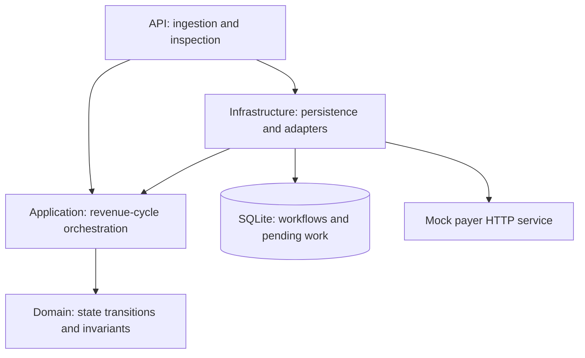

# Architecture

## Current executable surface

The scaffold contains two independent ASP.NET Core processes exposing `GET /` and `GET /health`. The domain holds an initial workflow-stage enum and correlation record. Infrastructure is an empty assembly reserved for adapters. No workflow, persistence, parsing, claim endpoint, or telemetry exporter is implemented.

## Target Phase 1 design

Arrows inside the application describe source dependencies; arrows to external components describe runtime integration. The API is the composition root. Domain has no framework or persistence dependency. Application will own orchestration and adapter contracts; Infrastructure will implement them. The mock payer is independently deployable and must not reuse internal orchestration logic.

SQLite is the proposed local durable store, with transactional pending-work records and a hosted worker. This keeps the initial demo reproducible without a broker. A broker or production database can later replace an adapter when there is an explicit requirement; the scaffold makes no scale or availability claim.

## Workflow and correlation

The intended initial path is `EncounterReceived -> ClinicalContextReady -> ClaimCreated -> SubmissionPending -> Submitted`, with `RetryScheduled` and `ManualReview` recovery paths. These names exist today; guarded transitions and history do not.

| Identifier | Meaning and assignment |
| --- | --- |
| WorkflowId | Internal workflow identity |
| EncounterId | Source clinical encounter identity |
| ClaimId | Claim identity assigned when a claim is created |
| PayerClaimId | Mock payer identity assigned on receipt |
| TraceNumber | Future remittance/payment business trace; nullable until known |
| PaymentReference | Future bank settlement reference; nullable until known |

Business trace numbers are distinct from OpenTelemetry trace IDs. The initial record is a vocabulary, not a final reconciliation schema: later phases must represent split payments, batches, adjustments, and many-to-many claim/payment relationships.

## Clinical and administrative boundaries

FHIR R4 is the first planned ingestion format. Only a documented resource subset will be accepted. HL7 v2 will enter through a separate normalization adapter later. Clinical records are not automatically billable: diagnosis/procedure/billing details must be supplied explicitly and validated.

The 837 adapter will emit a declared educational professional-claim subset. Payer HTTP receipt is not a 277CA acknowledgment, adjudication, or payment. Later phases distinguish technical acknowledgment, claim acknowledgment (277CA), claim status (277), remittance (835), and bank settlement.

## Reliability requirements for the next increment

- Store workflow changes and pending submission work atomically.
- Use ingestion keys plus payload fingerprints to detect both duplicates and conflicts.
- Persist stable payer submission keys and mock-payer deduplication across restarts.
- Retry transient failures with finite budgets, backoff, jitter, and timeouts. Route permanent or exhausted failures to manual review.
- Add circuit breaking without treating an open circuit as successful submission.
- Record recovery requests and guard against simultaneous processing and requeue.
- Test acceptance followed by a lost HTTP response; do not claim exactly-once delivery.

## Observability and execution boundary

OpenTelemetry tracing, metrics, structured logs, and local OTLP visualization are planned. Log identifiers and operational metadata, not patient payloads. Avoid identifiers as metric labels. Inspection endpoints will expose persisted history and attempts.

The current hosts have no authentication and are intended for loopback demos. Authentication, authorization, transport security, secret management, migrations, and operational hardening must be designed before any public hosting. Synthetic-only intent is not an implemented real-data detector.
